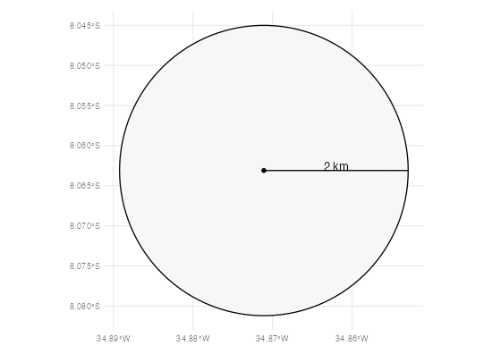
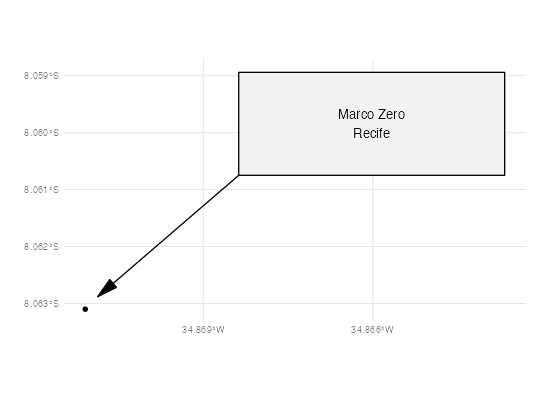
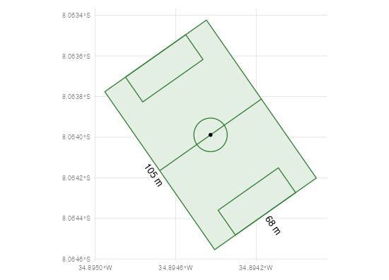
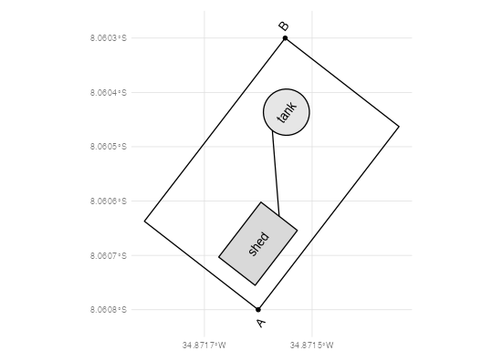
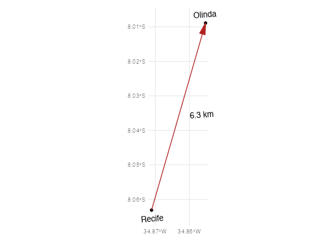
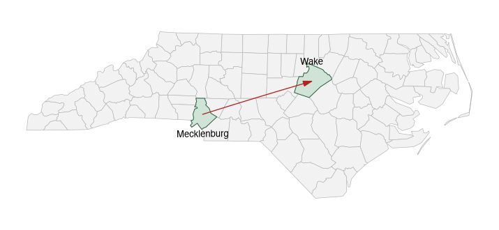

```{r setup, include = FALSE}
knitr::opts_chunk$set(collapse = TRUE, comment = "#>", eval = FALSE)
```

A pic drawing is laid out on a plane in inches. Tell rpic where that plane
sits on the Earth and the same drawing becomes geographic data. Three lines
of pic do it: an anchor, a scale, and the drawing:

```{r}
library(rpic)

pic('
geo_lon = -34.8711; geo_lat = -8.0631   # the pic origin: Marco Zero, Recife
geo_scale = 1000                         # one inch of the drawing is 1 km
C: circle rad 2 at (0, 0) dashed fill 0.97
line from C.c to C.e thin
"2 km" above at 0.5 <C.c, C.e>
') |>
  autoplot()
```



`autoplot()` (from ggplot2) is the quick look. Underneath it, `rpic_sf()`
turns the drawing into an `sf` data frame for `ggplot2::geom_sf()`, mapgl,
or any other spatial tool, and `rpic_geojson()` returns the GeoJSON text
itself — a `FeatureCollection` in WGS84 longitude/latitude. Boxes and
circles become polygons, lines and arrows line strings (arrowheads are
features of their own), dots and texts points.

`rpic_sf()` needs the `sf` package (`install.packages("sf")`);
`rpic_geojson()` needs nothing beyond rpic. The format — registration,
geometry per kind, properties, warnings — is specified in the engine's
[docs/geopic.md](https://github.com/milkway/rpic-lang/blob/main/docs/geopic.md).

## What comes back

One row per feature. Every feature keeps its pic style in
[simplestyle](https://github.com/mapbox/simplestyle-spec) columns next to
the `geopic_*` ones; the column names are the GeoJSON property names in
snake_case (`rpic_sf_names()` does the renaming):

```{r}
radius <- pic('
geo_lon = -34.8711
geo_lat = -8.0631
geo_scale = 1000         # metres per inch

C: circle rad 2 at (0, 0) dashed fill 0.97
dot at C.c rad 0.04
line from C.c to C.e thin
"2 km" above at 0.5 <C.c, C.e>
') |>
  rpic_sf()

names(radius)
#>  [1] "fill"             "geopic_anchor"    "geopic_dash"      "geopic_font_size"
#>  [5] "geopic_id"        "geopic_kind"      "geopic_label"     "geopic_placement"
#>  [9] "geopic_radius_in" "geopic_rotation"  "geopic_schema"    "geopic_text"
#> [13] "geopic_z"         "stroke"           "stroke_width"     "title"
#> [17] "geometry"

radius[, c("geopic_id", "geopic_kind", "geopic_text", "geopic_anchor", "stroke", "fill")]
#>   geopic_id geopic_kind geopic_text geopic_anchor  stroke    fill
#> 1        s0      circle        <NA>          <NA> #000000 #f7f7f7
#> 2        s1         dot        <NA>          <NA> #000000 #000000
#> 3        s2        line        <NA>          <NA> #000000    <NA>
#> 4        s3        text        2 km             s    <NA>    <NA>
```

The columns worth knowing:

- `geopic_kind` — `box`, `circle`, `ellipse`, `line`, `arrow`, `arrowhead`,
  `dot`, `text`, and `title` for the label a shape carries (a point at the
  label's centre, right after the shape's own row).
- `geopic_id` — the SVG id of the same object (`s0`, `s1`, ...), so a
  feature can be matched to `rpic_objects()`, to the scene or to the SVG.
- `stroke`, `stroke_width`, `fill`, `geopic_dash` — the style as drawn;
  colours are hex strings already.
- `geopic_text`, `geopic_anchor`, `geopic_rotation`, `geopic_font_size` —
  what a text says and where it sits relative to its point: the anchor is
  pic's compass (`"s"` for `above`: the point is at the text's bottom, `"w"`
  for `ljust`, `"c"` centred), the rotation is in degrees counter-clockwise
  from east, and the font size is in points.
- `geopic_placement` — `"screen"` for texts, dots and objects with
  `class "screen"`: a hint to interactive maps that these are annotations to
  keep at screen size; `"geo"` otherwise.

The registration used comes back as an attribute:

```{r}
str(attr(radius, "registration"))
#> List of 7
#>  $ anchor        :List of 2
#>   ..$ lat: num -8.06
#>   ..$ lon: num -34.9
#>  $ bearing_deg   : num 0
#>  $ control_points: num 0
#>  $ frame         : chr "enu"
#>  $ method        : chr "anchor"
#>  $ origin        : num [1:2] 0 0
#>  $ scale_m_per_in: num 1000
```

## Drawing it with ggplot2

The figures in this vignette were pre-rendered (`data-raw/vignette-figures.R`
in the source repository) with a small helper that draws pic colours as they
are, puts each text where pic put it — the anchor and rotation columns become
`hjust`, `vjust` and `angle` — and shows the longitude/latitude grid so the
drawing's place and size on the Earth are visible:

```{r}
library(ggplot2)

pic_layers <- function(x) {
  shapes <- x[!x$geopic_kind %in% c("text", "title"), ]
  labels <- x[x$geopic_kind %in% c("text", "title"), ]
  a <- ifelse(is.na(labels$geopic_anchor), "c", labels$geopic_anchor)
  labels$hjust <- ifelse(grepl("e", a), 1, ifelse(grepl("w", a), 0, 0.5))
  labels$vjust <- ifelse(grepl("n", a), 1, ifelse(grepl("s", a), 0, 0.5))
  labels$angle <- ifelse(is.na(labels$geopic_rotation), 0, labels$geopic_rotation)
  list(
    geom_sf(data = shapes, aes(fill = fill, colour = stroke), linewidth = 0.4),
    geom_sf_text(data = labels,
                 aes(label = geopic_text, hjust = hjust, vjust = vjust, angle = angle),
                 size = 3, fun.geometry = function(g) g),
    scale_fill_identity(), scale_colour_identity(),
    coord_sf(clip = "off"), scale_x_continuous(n.breaks = 4), labs(x = NULL, y = NULL),
    theme_minimal(base_size = 8)
  )
}

ggplot() + pic_layers(radius)
```

`autoplot()` draws a georeferenced `pic()` the same way in one call, and
this helper is what to start from for anything more: a basemap under the
drawing (add its `geom_sf()` layers before `pic_layers()`), pic's own line
widths (`stroke_width`), another theme.

## Registration

The drawing is placed by a similarity with four parameters, declared as pic
variables or passed as arguments (an argument wins over the source):

| pic variable | argument | meaning |
|---|---|---|
| `geo_lon`, `geo_lat` | `anchor = c(lon, lat)` | where the pic origin `(0, 0)` is |
| `geo_scale` | `scale` | metres per inch of the drawing (default 100) |
| `geo_bearing` | `bearing` | azimuth of the drawing's +y axis, degrees clockwise from north |
| `geo_frame` | `frame` | `"enu"` (local tangent plane, true distances; default) or `"mercator"` |

Or the drawing names **control points**: a place `A: (x, y)` with `A_lon`
and `A_lat`. One control point anchors the drawing there; two fix the scale
and bearing exactly; three or more are fitted by least squares, with the
residual reported in the registration attribute (`rms_m`).

Three different "scales" meet here, and it helps to keep them apart:

- pic's own `scale` sets how many **pic units** make an inch (`scale = 10`:
  a `box wid 40` is four inches wide). It is how a drawing is authored in
  metres or in any other unit.
- `geo_scale` sets how many **metres** an inch of the drawing is on the
  ground. With `scale = 20` and `geo_scale = 20`, pic units are metres.
- Text sizes are in points and do not scale with the drawing: a `"2 km"`
  label is 11 pt on paper whatever `geo_scale` says. On the ground that is
  `font_size / 72 × geo_scale` metres tall (`geopic_font_size`), which is
  how interactive maps keep labels in proportion to the shapes at any zoom
  — and why a label can need `text_scale` on a map (below).

The default frame, `"enu"`, lays the plane tangent to the ellipsoid at the
anchor: every distance and angle of the drawing is true on the ground, which
is what a site plan, a radius or a route wants. `"mercator"` lays it on the
Web Mercator plane instead, so straight lines stay straight on a web map and
north is up at any latitude; distances are then Mercator distances, which at
Recife's latitude is a 1 % stretch.

## A callout pinned to one place

`geo_lon`/`geo_lat` put the pic origin on Recife's Marco Zero and
`geo_scale` makes one inch 400 m:

```{r}
callout <- pic('
geo_lon = -34.8711
geo_lat = -8.0631
geo_scale = 400          # metres per inch

dot at (0, 0) rad 0.04
B: box "Marco Zero" "Recife" wid 1.3 ht 0.5 at (1.4, 0.9) fill 0.95 class "screen"
arrow from B.sw to (0.06, 0.06) thick 1.2
') |>
  rpic_sf()
ggplot() + pic_layers(callout)
```



The box carries `class "screen"`: its `geopic_placement` is `"screen"`, a
hint for interactive maps that it is an annotation to keep at screen size
(dots and texts are screen-placed too).

## A geodesic radius

With one inch a kilometre, a circle of radius 2 is a 2 km circle around the
anchor — the first figure above. Lines are densified in the plane before they
go to longitude/latitude, so every vertex is 2 000 m from the centre along
the ellipsoid, not a circle in degree space (a degree of latitude is longer
than a degree of longitude here, as the grid's unequal spacing shows).

## Orienting the drawing

`geo_bearing` turns the whole drawing: the +y axis of the plane points that
many degrees east of north. A football pitch drawn in metres (`scale = 20`
with `geo_scale = 20`), laid at 55°:

```{r}
pitch <- pic('
geo_lon = -34.8947
geo_lat = -8.0636
geo_scale = 20           # one inch is 20 m
geo_bearing = 55         # the +y axis points 55 degrees east of north
scale = 20               # so pic units are metres
margin = 3

Field: box wid 105 ht 68 shaded "#e4efe4" outlined "#2e7d32"
line from Field.n to Field.s outlined "#2e7d32"
circle rad 9.15 at Field.c outlined "#2e7d32"
box wid 16.5 ht 40.3 with .w at Field.w outlined "#2e7d32"
box wid 16.5 ht 40.3 with .e at Field.e outlined "#2e7d32"
dot at Field.c rad 0.3
"105 m" below at Field.s + (0, -2)
"68 m" ljust at Field.e + (2, 0)
') |>
  rpic_sf()
ggplot() + pic_layers(pitch)
```



The texts turn with the drawing: their `geopic_rotation` is −55°, and the
helper passes it to `angle`. (`shaded`/`outlined` set fill and stroke
separately; `color` would set both.)

## Registering a sketch by two surveyed corners

A site plan drawn in metres (`scale = 10` puts ten pic units in an inch),
oriented however was convenient on paper. Two corners whose coordinates
were surveyed register it; scale and bearing come out of the fit, so the
plan lands rotated to true north on its own:

```{r}
site <- pic('
scale = 10
margin = 2.5

A: (0, 0)
A_lon = -34.8716
A_lat = -8.0608
B: (40, 25)
B_lon = -34.87155
B_lat = -8.06030

Yard: box wid 40 ht 25 with .sw at A
Shed: box "shed" wid 12 ht 8 with .sw at A + (3, 3) fill 0.85
Tank: circle "tank" rad 4 at A + (30, 17) fill 0.9
line from Shed.e to Tank.w dashed
dot at A rad 0.4
dot at B rad 0.4
"A" at A + (-1.5, -1.5)
"B" at B + (1.5, 1.5)
') |>
  rpic_sf()
attr(site, "registration")$method       # "two_points"
ggplot() + pic_layers(site)
```



## An arrow between two features

Two control points fix the whole registration, so a drawing can be made in
any convenient units and still land with the right size — here the 6.3 km
between Recife and Olinda:

```{r}
arrow <- pic('
Recife: (0, 0)
Recife_lon = -34.8711
Recife_lat = -8.0631
Olinda: (0.6, 1.6)
Olinda_lon = -34.8553
Olinda_lat = -8.0089

dot at Recife rad 0.04
dot at Olinda rad 0.04
arrow from Recife to Olinda thick 1.5 color "firebrick"
"Recife" below at Recife + (0, -0.05)
"Olinda" above at Olinda + (0, 0.05)
"6.3 km" ljust at 0.5 <Recife, Olinda> + (0.1, 0)
') |>
  rpic_sf()
ggplot() + pic_layers(arrow)
```



### Features from your own data

The places do not have to be written in the source. `features` hands rpic
named features from R — a named list of `c(lon, lat)`, a data frame with
`name`, `lon`, `lat`, or an `sf` object — and the source just uses their
names. With `sf`, each feature's point is its centroid and its bounding box
becomes an invisible pic box, so `Wake.n` is the top of Wake county. Here,
two counties of the North Carolina dataset that ships with `sf`:

```{r}
nc <- sf::st_read(system.file("shape/nc.shp", package = "sf"), quiet = TRUE)
two <- nc[nc$NAME %in% c("Mecklenburg", "Wake"), ]

route <- pic('
geo_scale = 50000        # one inch is 50 km
arrowht = 0.3; arrowwid = 0.18
arrow from Mecklenburg to Wake thick 1.5 color "firebrick"
"Wake" above at Wake.n
"Mecklenburg" below at Mecklenburg.s
') |>
  rpic_sf(features = two, name_col = "NAME")

ggplot() +
  geom_sf(data = nc, fill = "grey95", colour = "grey70", linewidth = 0.2) +
  geom_sf(data = two, fill = "#cfe3d6", colour = "#2f5d43", linewidth = 0.3) +
  pic_layers(route)
```



A feature the source defines itself (a place, or a labelled object) is a
control point of the drawing's own geometry; the others are placed first and
then injected, so the arrow starts and ends exactly at the two centroids.
Here no anchor is declared, so the features place the drawing: `geo_scale`
still sets how large pic's own lengths are — arrowheads, text offsets —
on the ground. Feature names must be pic labels (an uppercase letter, then
letters, digits or underscores); anything else is an error, never written
into the source. The data are transformed to WGS84 first when they are in
another CRS (`nc` is NAD27).

## Warnings and errors

What GeoJSON cannot carry is reported, never dropped silently: a gradient
fill keeps its first colour, animations are ignored, a control point that
names no label is skipped. Each kind of loss raises one R warning of class
`rpic_geo_warning` (inheriting `rpic_warning`), and the full list rides in
the `"warnings"` attribute:

```{r}
gj <- withCallingHandlers(
  pic('geo_lon = 0; geo_lat = 0
box gradient "red" "blue"') |>
    rpic_geojson(),
  rpic_geo_warning = function(w) invokeRestart("muffleWarning")
)
attr(gj, "warnings")[[1]]$kind   # "unsupported_style"
rpic_warnings(gj)$kind           # the same, as a data frame
```

A drawing that cannot be placed raises `rpic_geo_error` (an `rpic_error`),
with a machine-readable `kind` and a hint:

```{r}
tryCatch(pic("box") |> rpic_geojson(), rpic_geo_error = function(e) e$info$kind)
#> [1] "no_registration"
```

## In R Markdown and Quarto

The knitr engine (`rpic_register_knitr()`) georeferences a chunk with
`geo = TRUE`: instead of a figure, the chunk assigns `rpic_sf()`'s result to
a variable named after the chunk label (or the chunk option `geo.var`), for
the R chunks that follow. Georeferencing options ride as `geo.anchor`,
`geo.scale`, `geo.features`, ...:

````
```{rpic radius, geo=TRUE}
geo_lon = -34.8711; geo_lat = -8.0631; geo_scale = 1000
circle rad 2 at (0, 0) fill 0.97
```

```{r}
ggplot(radius) + geom_sf(aes(fill = fill)) + scale_fill_identity()
```
````

## Interactive with mapgl

`add_rpic()` puts a drawing on a MapLibre map from
[mapgl](https://walker-data.com/mapgl/), styled by the engine's own layers
(`rpic_maplibre_layers()`) — the ones
[rpic.dev's Maps page](https://rpic.dev/docs/maps/) draws with, every stroke
width, dot and label **true to the ground**:

```{r}
library(mapgl)

maplibre(style = carto_style("positron")) |>
  add_rpic(radius, before = "labels", text_scale = 1.5)
```

Like mapgl's own `add_*()` verbs it takes the map first, then the drawing —
a `pic()`, an `rpic_geojson()` result or an `rpic_sf()` data frame such as
`radius` above — and fits the map to the drawing. `before = "labels"` slips
the drawing's shapes under the basemap's place names (its own labels stay on
top), and `text_scale = 1.5` enlarges the drawing's labels, which are sized
to the ground and can come out small against a city. (`rpic_mapgl()` is the
same function under its earlier name.) Live maps, and what the helper does
step by step, are in the article
[Interactive maps with mapgl](https://milkway.github.io/rpic-r/articles/mapgl.html)
on the package website.

To try a drawing on a map before bringing it into R, paste it into the
[rpic Studio](https://studio.rpic.dev): a source with `geo_lon`/`geo_lat` or
control points opens a **Map** tab next to the picture, re-georeferenced as
you type, with a GeoJSON download.
