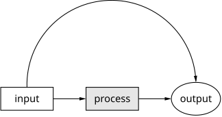
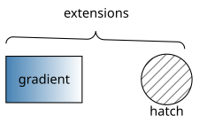

```{r setup, include = FALSE}
knitr::opts_chunk$set(collapse = TRUE, comment = "#>", eval = FALSE)
```

rpic renders diagrams written in Brian Kernighan's **pic** picture-drawing
language: you describe a drawing by *walking around a plane dropping
primitives* — boxes, circles, lines, arrows — with relative positioning
doing the layout for you. The engine is pure Rust (no troff, no LaTeX, no
system dependencies) and outputs SVG, PNG and PDF.

All diagrams in this vignette were pre-rendered with `rpic_svg()` — the code
chunks show exactly the source that produced each figure. Wrap pic source in
`pic()` and pipe it into the function that renders or reads it:
`pic(src) |> rpic_svg()`, `pic(src) |> rpic_png("a.png")`,
`pic(src) |> rpic_objects()`. (Every function also takes a plain string.) The full language
reference, extension pages and a live playground are at
[rpic.dev](https://rpic.dev).

## A first picture

Primitives placed in sequence flow in the current direction (right, by
default); `arrow` connects them; `arc` bends between named positions:

```{r}
library(rpic)

flow <- pic('
boxht = 0.35; boxwid = 0.8
A: box "input"
arrow
box "process" fill 0.9
arrow
E: ellipse "output"
arc cw -> from A.n to E.n
')
flow
#> <pic source: 8 lines, 124 characters>
#>   
#>   boxht = 0.35; boxwid = 0.8
#>   A: box "input"
#>   arrow
#>   box "process" fill 0.9
#>   arrow
#>   ... 2 more lines

svg <- flow |> rpic_svg()
flow |> rpic_png("flow.png", scale = 2)
```



Printed at the console, a `pic()` shows a summary of its source and — in an
interactive session — opens the drawing in the viewer; left visible at the
end of an R Markdown or Quarto chunk, it is drawn as the chunk's figure.

## Positioning

Objects can be labelled (`A:`), addressed by compass corners (`.n`, `.e`,
`.c`, …) or by ordinals (`last circle`, `2nd box`), and placed with
expressions — including fractions of the way between two points:

```{r}
pic('
A: box "A" wid 0.6 ht 0.4
B: box "B" wid 0.6 ht 0.4 at A + (1.6, 0)
line dashed from A.e to B.w
circle rad 0.06 fill 0 at 1/2 between A.e and B.w
"midpoint" at last circle.s below
arrow from A.n up 0.3 then right 1.6 then down 0.3 to B.n
"the long way" at 1/2 between A.n and B.n + (0, 0.42)
') |>
  rpic_svg()
```


## Programmability

pic is a little language: `for`/`if`, variables, `define` macros with
`$1…$9`, and `sprintf` are all built in:

```{r}
pic('
for i = 0 to 5 do {
  circle rad 0.12 fill i/6 at (i * 0.4, 0)
}
') |>
  rpic_svg()
```


## TeX math labels

With `texlabels = TRUE` (or `texlabels = 1` in the source), a label written
entirely as `$…$` is typeset as TeX math, natively — KaTeX-grade quality
with exact metrics, so boxes `fit` around formulas correctly. `pic()` turns
`texlabels` on by itself when some label is entirely `$…$` (and `circuits`
when the source calls a circuit element); pass `texlabels = FALSE` to keep
the dollars literal. Write TeX commands with a single backslash in the pic
source (escaped as `\\` inside an R string):

```{r}
math <- pic('
box "$\\frac{1}{2\\pi}\\int_{-\\infty}^{\\infty} f(t)\\,e^{-i\\omega t}\\,dt$" fit
')
attr(math, "texlabels")
#> [1] TRUE
math |> rpic_svg()
```


## rpic extensions

Beyond classic pic, opt-in extensions cover linear `gradient` fills, `hatch`
patterns, curly `brace` annotations, `margin`, `fit`, `opacity`, layers
(`behind`) and more — each documented with live examples at
[rpic.dev](https://rpic.dev/docs/extensions/margin/). They are inert for
classic input:

```{r}
pic('
B: box wid 0.9 ht 0.55 gradient "steelblue" "white"
"gradient" at B.c
C: circle rad 0.3 hatch hatchangle 45 at B.e + (1.0, 0)
"hatch" at C.s below
brace from B.nw + (0, 0.15) to C.ne + (0, 0.15) up "extensions"
') |>
  rpic_svg()
```



## Drawing data

`rpic_objects()`, `rpic_places()` and `rpic_warnings()` read the compile
bundle as data frames, one row per object, named place or warning — with the
source position of each, so a tool can point back at the line that drew it:

```{r}
flow |> rpic_objects()
#>   id    kind line col end_col file  bbox_x0  bbox_y0  bbox_x1  bbox_y1 link
#> 1 s0     box    3   4       7 <NA>   1.0667 127.7333  77.8667 161.3333 <NA>
#> 2 s1    path    4   1       6 <NA>  77.8667 142.1333 125.8667 146.9333 <NA>
#> 3 s2     box    5   1       4 <NA> 125.8667 127.7333 202.6667 161.3333 <NA>
#> 4 s3    path    6   1       6 <NA> 202.6667 142.1333 250.6667 146.9333 <NA>
#> 5 s4 ellipse    7   4      11 <NA> 250.6667 120.5333 322.6667 168.5333 <NA>
#> 6 s5     arc    8   1       4 <NA>  39.4667   0.5333 288.4015 127.7333 <NA>

w <- pic('A: (0, 0)\nbox foo') |> rpic_warnings()
w[, c("kind", "line", "col", "found", "hint")]
#>                kind line col found                hint
#> 1 ignored_attribute    2   5   foo did you mean `fit`?
```

Bounding boxes are in SVG viewBox units (`bbox_x0`, `bbox_y0` the top-left
corner); `rpic_compile()` returns the whole bundle as a list when you need
more (animations, the scene).

## Errors you can point at

Compile failures raise a classed `rpic_error` condition whose `info` field
carries the structured diagnostic — position (always relative to *your*
source), kind, and a did-you-mean hint:

```{r}
tryCatch(
  pic("bxo") |> rpic_svg(),
  rpic_error = function(e) list(line = e$info$line, hint = e$info$hint)
)
#> $line
#> [1] 1
#> $hint
#> [1] "did you mean `box`?"
```

## Where next

- `vignette("circuits")` — the native circuit-element library;
- `vignette("class-and-animate")` — CSS class hooks and the animation
  manifest;
- `rpic_register_knitr()` — write pic directly in R Markdown / Quarto
  chunks;
- [rpic.dev](https://rpic.dev) — the full language documentation.
